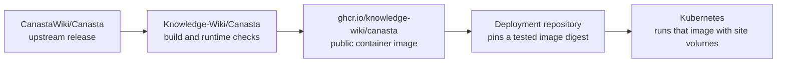

# Knowledge-Wiki Canasta image

This fork owns the Canasta runtime build. Deployment repositories consume its
published image by SHA-256 digest and keep their site configuration, extensions,
credentials, databases and uploads outside this repository.



## Current release scope

- The `knowledge-wiki` branch starts at upstream Canasta 3.5.20, commit
  `004d9be33de2e677b94514695977abf9d7cfd54c`. `master` retains the upstream branch.
- The patch Dockerfile uses the existing release's exact AMD64 image:
  `ghcr.io/canastawiki/canasta@sha256:e2d3f9ca1441ac3ec8d2aa8e972abc493984af1a4cc16fe2b17c866ec3954e84`.
  It is the AMD64 member of upstream multi-platform digest
  `sha256:52b756f614823d56a359d1182b30998a6e629d46d41c388c4234232dcb1b0920`.
- This retains Canasta 3.5.20, MediaWiki 1.43.9 and the parent's existing root
  libraries. It upgrades the installed Debian PHP 8.2 packages from 8.2.32 to
  `8.2.35-1~deb12u1`. This release supports Linux AMD64 only.
- Startup validates the reviewed Composer inputs and refreshes autoload files
  without resolving or downloading packages. Dependency changes fail startup.
  The pinned SemanticResultFormats 5.2.0 source at
  `a2682d7841c442e82533360fd0f35e2b40c17d68` is accepted when mounted because its
  runtime dependency definitions match the bundled source.
- Automatic database maintenance and the container's internal job runner are
  disabled by default. Deployments control maintenance and scheduled jobs.
- The helper used by both web startup and external jobs is
  `/opt/canasta-runtime/prepare-composer.sh`.

The upstream root Dockerfile and extension inventory are retained for tracking
upstream. The release described here is built with `knowledge-wiki/php-runtime`;
building the repository root produces the upstream recipe instead. Keeping the
existing published parent avoids re-resolving its application dependencies
during this targeted PHP patch.

## Build and verify

On an AMD64 Docker host:

```sh
docker build --platform linux/amd64 -t knowledge-wiki-canasta:php8.2.35 knowledge-wiki/php-runtime
bash knowledge-wiki/verify-runtime-image.sh knowledge-wiki-canasta:php8.2.35
```

The `Build Knowledge-Wiki Canasta` workflow builds and tests on native AMD64.
It verifies CLI and FPM versions, configuration syntax, locked dependency
preservation, rejected dependency drift, and a real Apache/PHP-FPM web request.
Only the `knowledge-wiki` branch publishes an image. Pull requests only build
and test. The original upstream publishing and issue-creation workflows are
restricted to the upstream repository.

Deployment-specific extension compatibility checks belong to each deployment
repository. A successful runtime build alone does not establish that a live
wiki farm works with this release.

## Public image delivery

The package is `ghcr.io/knowledge-wiki/canasta`. Builds use a commit-specific tag
and record the immutable pull reference in the `canasta-runtime-validation`
artifact (`image-digest.txt`). Deployments must use that `@sha256:` reference.

GitHub initially creates container packages as private even for public
repositories. On first publication, an organization owner must set the package
visibility to **Public** in
[package settings](https://github.com/orgs/Knowledge-Wiki/packages/container/canasta/settings).
This applies only to the software image from this public fork. Private
deployment repositories and their data remain private.

The workflow has a separate anonymous-download job with no registry login. It
must pass before a deployment is promoted; if the initial publication is still
private, change the package visibility and rerun that failed job. Consumers of
the public image do not need registry credentials.

## Updating the fork

Keep upstream changes reviewable through an `upstream` remote. For each update,
review the upstream source and base image, choose immutable image references,
update the PHP package version and reviewed dependency inputs, and run the
runtime checks. Then run the consuming deployment's compatibility checks and
staged TEST rollout before promoting its digest. This repository never deploys
to a cluster automatically.
